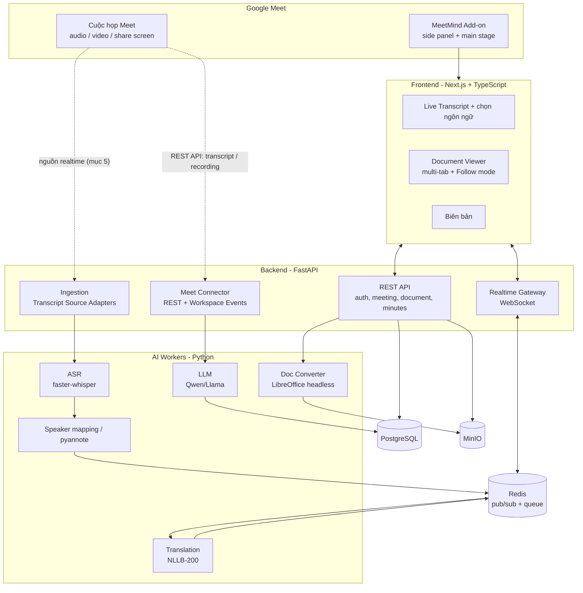
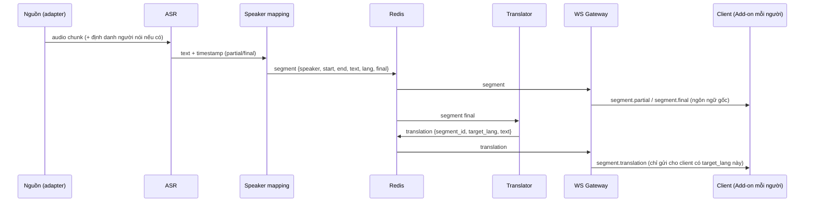

# MeetMind AI – Kiến trúc & Kế hoạch triển khai (họp trên Google Meet, MeetMind chạy như Add-on)

> Trạng thái: bản nháp v0.2 (chuyển từ Teams sang Google Meet).
> Các mục đánh dấu **⚠ SPIKE** là giả định chưa xác minh, phải kiểm chứng bằng thử nghiệm kỹ thuật trước khi cam kết. Thông tin về API Google dựa trên tài liệu công khai, một số trang cập nhật khoảng giữa 2025; cần đối chiếu lại với tài liệu hiện hành.

---

## 1. Mục tiêu và phạm vi

### 1.1. Bài toán
Cuộc họp diễn ra trên **Google Meet**. MeetMind AI chạy **trong Meet dưới dạng Add-on** (side panel và main stage), đồng thời có web app độc lập để xem lại biên bản. Hệ thống giúp:

| # | Yêu cầu | Ưu tiên |
|---|---|---|
| R1 | Mọi người xem **nội dung cuộc họp realtime** (transcript trực tiếp) | Must |
| R2 | Mỗi người **chọn ngôn ngữ hiển thị riêng**, nội dung được dịch tương ứng | Should (làm sau nếu khó) |
| R3 | **Phân biệt người đang nói** (theo tên tài khoản) | Must |
| R4 | Cuối cuộc họp có **biên bản** (tóm tắt, quyết định, action item, người phụ trách, deadline) | Must |
| R5 | **Chủ trì upload tài liệu**; thành viên xem được | Must |
| R6 | Có **nhiều tài liệu, mở nhiều tab**; chuyển tab **giữ nguyên vị trí cuộn** của từng tài liệu | Must |
| R7 | **Đồng bộ vị trí đọc**: một người (presenter) đưa tất cả mọi người tới đúng vị trí cần đọc | Should |

### 1.2. Ngoài phạm vi (giai đoạn này)
- Tự xây hạ tầng họp (WebRTC/SFU). Meet lo audio/video/chia sẻ màn hình/ghi âm.
- Nhận diện khuôn mặt.
- Ngôn ngữ ít tài nguyên.
- Chỉnh sửa tài liệu cộng tác (chỉ xem).

---

## 1.3. Quyết định giao diện: hai tab trước, nâng cấp sau

**Giai đoạn 1 (hiện tại)**: web MeetMind quản lý người dùng và phiên họp; cuộc họp mở ở **tab/cửa sổ Meet riêng**. Hệ thống gọi **bot Attendee** vào họp bằng link Meet; người dùng xem phụ đề, tài liệu, biên bản trên web MeetMind.

| Việc | Cách làm ở giai đoạn 1 |
|---|---|
| Vào họp | Nút "Tham gia họp" mở Meet (popup có kích thước nếu trình duyệt cho phép) |
| Xếp hai cửa sổ cạnh nhau | Hướng dẫn người dùng xếp cửa sổ (Snap); không tự động hoàn toàn |
| Phụ đề khi đang ở tab Meet | Tùy chọn: Document Picture-in-Picture (chỉ Chromium) |
| Điện thoại | Web responsive; chuyển qua lại giữa app Meet và trình duyệt |

**Nâng cấp sau**: Meet Add-on (cùng codebase web, mở trong side panel/main stage), Picture-in-Picture cho phụ đề nổi. Mục 2–5 bên dưới mô tả hướng add-on; **giai đoạn 1 không phụ thuộc vào add-on**, chỉ cần bot và web.

---

## 2. Vì sao Meet, và Meet giải quyết được gì

| Mảng | Meet cho gì | Đánh giá |
|---|---|---|
| **Giao diện trong cuộc họp** | **Meet Add-ons SDK**: app của mình mở trong *side panel* và *main stage* ngay trong Meet; có **Co-Doing API** để đồng bộ trạng thái giữa mọi người | **Tốt hơn Teams** cho module tài liệu và đồng bộ vị trí đọc |
| **Biên bản sau họp** | **Meet REST API**: `conferenceRecords`, transcript và các entry, recording; **Workspace Events API** để nhận thông báo | Tốt. **⚠ SPIKE**: kiểm tra gói Workspace nào có transcript và quyền cần thiết |
| **Nội dung realtime** | **Meet Media API**: app nhận audio/video realtime qua WebRTC | **Còn Developer Preview** với nhiều ràng buộc (mục 4). Đây vẫn là phần rủi ro nhất |

Kết luận: Meet **thuận lợi hơn Teams cho giao diện và đồng bộ tài liệu**, nhưng **không giải quyết sẵn bài toán realtime**; vì vậy kiến trúc giữ adapter nguồn nội dung.

---

## 3. Quyết định kiến trúc chính

| Quyết định | Lựa chọn | Lý do |
|---|---|---|
| Nền tảng họp | Google Meet | Add-ons SDK có sẵn, API tạo cuộc họp và transcript |
| Cách tích hợp | **Meet Add-on (side panel + main stage) + Meet REST API** | Dùng giao diện của Meet, không cần tự xây phòng họp |
| Backend | **FastAPI (Python)** một service chính | AI và API cùng ngôn ngữ |
| Realtime client | WebSocket qua Redis pub/sub | Phụ đề, bản dịch, trạng thái presenter |
| Đồng bộ vị trí đọc | Co-Doing API của Add-on, hoặc WebSocket riêng (**⚠ SPIKE** chọn một) | Co-Doing đơn giản hơn; WebSocket riêng linh hoạt hơn |
| Nguồn nội dung | **Adapter nguồn** thay thế được (mục 4) | Realtime là rủi ro lớn nhất |
| Tài liệu | Convert sang PDF, xem bằng PDF.js | Một viewer duy nhất |
| Lưu trữ | PostgreSQL + MinIO + Redis | Chuẩn, chạy bằng Docker |

---

## 4. Kiến trúc tổng thể



### 4.1. Thành phần

| Thành phần | Trách nhiệm |
|---|---|
| **Meet Add-on** | Khung nhúng web app MeetMind vào Meet. Side panel hiển thị transcript và danh sách tài liệu; main stage hiển thị viewer tài liệu cho cả phòng. |
| **Frontend (Next.js)** | Live transcript, chọn ngôn ngữ, viewer nhiều tab, follow mode, trang biên bản. Dùng chung cho add-on và web độc lập. |
| **API (FastAPI)** | Xác thực, quản lý cuộc họp/người tham gia/tài liệu, trả biên bản. |
| **Realtime Gateway** | Giữ WebSocket, phát transcript, bản dịch, trạng thái presenter. |
| **Ingestion + Adapters** | Nhận nội dung cuộc họp từ nguồn (mục 5), chuẩn hóa về `segment`. |
| **Meet Connector** | Tạo/liên kết meeting space, nhận sự kiện kết thúc họp, lấy transcript và recording. |
| **AI Workers** | ASR, gán người nói, dịch, biên bản, convert tài liệu. |

---

## 5. Rủi ro lớn nhất: nguồn nội dung realtime từ Meet

| Nguồn realtime | Có tên người nói | Độ khó | Ghi chú |
|---|---|---|---|
| **M1. Meet Media API** (app nhận audio realtime qua WebRTC) | Có thể (audio kèm định danh người nói, **⚠ SPIKE** cách ánh xạ) | Trung bình–cao | **Developer Preview**: project Cloud, OAuth principal và **mọi người tham gia họp** phải ghi danh chương trình; scope bị giới hạn (restricted); cần cấu hình WebRTC đặc thù (ví dụ 3 audio transceiver). Tài liệu cho thấy preview có thể **không được dùng cho ứng dụng công khai** |
| **M2. Bot dịch vụ có sẵn** (Attendee mã nguồn mở tự host, hoặc Recall.ai trả phí) | Có | Thấp | Bot vào họp như người tham gia; Recall.ai là bên thứ ba nhận dữ liệu. **⚠ SPIKE** độ ổn định của Attendee với Meet |
| **M3. Add-on tự lấy audio** | Không | — | Add-on không truy cập được audio người khác nếu không có bot (thảo luận cộng đồng nhà phát triển). Không dùng |
| **M4. Chỉ sau họp** (REST: transcript + recording) | Có | Thấp | Luôn làm: đảm bảo biên bản chất lượng |

**Chiến lược**:
1. `TranscriptSource` là interface; mọi nguồn xuất ra cùng định dạng `segment` (mục 8.2).
2. **Tuần 1–2 làm spike** M1 và M2, chọn nguồn. M1 phù hợp pilot nội bộ (cả tổ chức ghi danh được); M2 phù hợp khi cần dùng với người ngoài hoặc muốn sớm có kết quả.
3. **M4 luôn có**: khi họp xong, transcript chuẩn từ REST thay thế bản realtime để làm biên bản.
4. Nếu realtime không đạt: sản phẩm vẫn có tài liệu đồng bộ và biên bản; phần phụ đề realtime làm bằng M2 hoặc hoãn.

---

## 6. Luồng xử lý

### 6.1. Trước họp
1. Chủ trì tạo cuộc họp Meet (hoặc MeetMind tạo meeting space qua Meet REST API) và mở Add-on MeetMind.
2. Chủ trì upload tài liệu; backend convert sang PDF và lưu MinIO.

### 6.2. Trong họp (realtime)


- Bản dịch chỉ tạo cho các ngôn ngữ **đang có người chọn**, cache theo `(segment_id, lang)`.
- Partial hiển thị ngay (chưa dịch), bản final mới được dịch.

### 6.3. Sau họp
1. Workspace Events API báo cuộc họp kết thúc và artifact sẵn sàng (thường cần chờ một lúc rồi mới lấy được transcript).
2. Meet Connector lấy transcript (có người nói) và recording; thay bản realtime bằng bản chuẩn.
3. LLM tạo biên bản theo JSON schema, kèm dẫn chiếu timestamp.
4. Người dùng xem, chỉnh sửa, xuất DOCX/PDF.

---

## 7. Module tài liệu (R5, R6, R7)

### 7.1. Upload và xử lý
- Chủ trì (và co-host) upload nhiều tài liệu: PDF, DOCX, PPTX, ảnh.
- Backend: kiểm tra loại và dung lượng, quét ClamAV, convert DOCX/PPTX sang PDF bằng LibreOffice headless, lưu bản gốc và PDF trên MinIO.
- Truy cập qua **presigned URL có hạn**, chỉ cấp cho người thuộc cuộc họp.
- Quyền tải xuống do chủ trì bật/tắt từng tài liệu.
- `doc.added` / `doc.removed` được phát để thành viên thấy ngay.

### 7.2. Viewer nhiều tab, giữ vị trí cuộn
Mỗi người có **một trạng thái xem riêng** cho mỗi tài liệu:

```ts
type ViewState = {
  docId: string
  page: number        // trang (1-based)
  yRatio: number      // 0..1, vị trí trong trang
  zoom: number
}
// store phía client: Map<docId, ViewState>
```

- **Rời tab**: lưu `ViewState` của tài liệu đó (cập nhật khi cuộn, có throttle).
- **Quay lại tab**: khôi phục `page` + `yRatio`, không cuộn về đầu.
- Danh sách trang ảo hóa (virtualized) để không tốn bộ nhớ khi có nhiều tài liệu lớn; vì vậy trạng thái nằm trong store, không dựa vào việc giữ DOM.
- Lưu thêm vào `localStorage` (tùy chọn lên server) để còn khi tải lại.
- Dùng **tỉ lệ trong trang**, không dùng pixel, để đúng với mọi kích thước màn hình và zoom (side panel hẹp, main stage rộng).

### 7.3. Đồng bộ vị trí đọc – Follow mode (R7)
Mục tiêu: một người đưa cả phòng tới đúng chỗ cần đọc.

**Vai trò**
- **Presenter**: mặc định là chủ trì; chủ trì có thể trao quyền cho người khác.
- **Follower**: những người còn lại.
- Chỉ **một presenter tại một thời điểm**. Người khác bấm "Xin quyền trình bày"; chủ trì hoặc presenter hiện tại duyệt hoặc chuyển giao.

**Hoạt động**
1. Presenter mở/cuộn tài liệu; client gửi `presenter.position` `{docId, page, yRatio, zoom, seq}` (throttle ~10 Hz, gửi ngay khi đổi tab hoặc tài liệu).
2. Trạng thái hiện tại được giữ trung tâm (Redis, hoặc Co-Doing API nếu chọn) và phát cho cả phòng. Người vào muộn nhận ngay trạng thái mới nhất.
3. Follower ở chế độ **Follow** tự mở đúng tài liệu và cuộn tới đúng vị trí (animation mượt).
4. Follower có thể **tách ra (Free mode)** bất cứ lúc nào. Khi cuộn tay lệch khỏi presenter, UI chuyển sang Free và hiện nút **"Quay lại vị trí của presenter"**.
5. Vị trí cá nhân từng tài liệu của follower **vẫn được lưu riêng** (7.2); có nút "Về chỗ đọc của tôi" để follow mode không làm mất vị trí đang đọc dở.

**Xung đột và thứ tự**: mỗi cập nhật có `seq` tăng dần, client bỏ gói cũ; server chỉ nhận cập nhật từ người đang giữ quyền; mất kết nối thì nhận lại trạng thái hiện tại.

**Gắn với Meet**: Add-on có thể mở viewer lên **main stage** để cả phòng cùng thấy. Cần chọn giữa Co-Doing API (Meet tự đồng bộ, đơn giản) và WebSocket riêng (linh hoạt, dùng được cả ngoài Meet) – **⚠ SPIKE** trong M0.

---

## 8. Dữ liệu và API

### 8.1. Mô hình dữ liệu (PostgreSQL)

| Bảng | Trường chính |
|---|---|
| `users` | id, google_sub, display_name, email, preferred_lang |
| `meetings` | id, meet_space_name, meeting_code, conference_record, organizer_id, title, started_at, ended_at, status |
| `participants` | id, meeting_id, user_id, meet_participant_id, role (host/cohost/member), display_lang |
| `documents` | id, meeting_id, uploader_id, name, mime, size, original_key, pdf_key, page_count, allow_download, order_idx |
| `segments` | id, meeting_id, participant_id (nullable), speaker_label, start_ms, end_ms, lang, text, is_final, source |
| `translations` | segment_id, target_lang, text, model |
| `minutes` | id, meeting_id, summary, topics (jsonb), decisions (jsonb), status |
| `action_items` | id, minutes_id, owner_participant_id, task, due_date, source_segment_id |

Trạng thái presenter và vị trí hiện tại **chỉ nằm trong Redis** (tạm thời).

### 8.2. Định dạng chuẩn `segment`

```json
{
  "id": "seg_01",
  "meeting_id": "m_01",
  "speaker": { "participant_id": "p_01", "name": "Nguyễn Văn A", "confidence": 0.97 },
  "start_ms": 0,
  "end_ms": 5200,
  "lang": "vi",
  "text": "Hôm nay chúng ta họp về dự án",
  "is_final": true,
  "source": "meet_rest"
}
```

### 8.3. Sự kiện WebSocket

| Hướng | Sự kiện | Nội dung |
|---|---|---|
| C→S | `join` | meeting_id, token |
| C→S | `set_lang` | target_lang |
| C→S | `presenter.claim` / `release` / `grant` | người nhận quyền |
| C→S | `presenter.position` | docId, page, yRatio, zoom, seq |
| S→C | `segment.partial` / `segment.final` | segment |
| S→C | `segment.translation` | segment_id, lang, text |
| S→C | `participants.update` | danh sách và vai trò |
| S→C | `doc.added` / `doc.removed` / `doc.updated` | tài liệu |
| S→C | `presenter.changed` | presenter mới |
| S→C | `presenter.position` | vị trí hiện tại |

### 8.4. REST chính

| Endpoint | Mô tả |
|---|---|
| `POST /meetings` | Tạo hoặc liên kết meeting space Meet |
| `GET /meetings/{id}` | Thông tin, trạng thái |
| `POST /meetings/{id}/documents` | Upload tài liệu (host/cohost) |
| `GET /meetings/{id}/documents` | Danh sách |
| `GET /documents/{id}/url` | Presigned URL xem hoặc tải |
| `DELETE /documents/{id}` | Xóa (host/cohost) |
| `GET /meetings/{id}/transcript?lang=` | Transcript theo ngôn ngữ |
| `GET /meetings/{id}/minutes` | Biên bản |
| `PATCH /minutes/{id}` | Chỉnh sửa biên bản |
| `GET /minutes/{id}/export?format=docx\|pdf` | Xuất file |

---

## 9. Pipeline AI

### 9.1. ASR
- `faster-whisper` (large-v3 hoặc nhỏ hơn tùy GPU); có thể thử PhoWhisper cho tiếng Việt.
- VAD, chạy streaming theo chunk cho realtime; language ID từng đoạn.
- Có thể dùng thuật ngữ từ tài liệu đã upload làm gợi ý cho ASR.

### 9.2. Người nói
- **Ưu tiên**: lấy theo metadata Meet (transcript REST có người nói; audio realtime kèm định danh nếu nguồn cho phép).
- **Dự phòng**: `pyannote.audio` phân biệt Speaker 1/2/3, ánh xạ sang tên bằng metadata hoặc cho gán tay.
- Hiển thị độ tin cậy; thấp thì gắn nhãn "chưa chắc chắn".

### 9.3. Dịch
- NLLB-200 (hoặc LLM Qwen cho một số cặp ngôn ngữ); service riêng, batch nhiều câu.
- Chỉ dịch ngôn ngữ đang được chọn; cache theo `(segment_id, lang)`; hỗ trợ glossary.
- Mục tiêu (cần đo): partial < 1,5 giây, bản dịch final < 3 giây.

### 9.4. Biên bản (LLM)
- Đầu vào: transcript chuẩn có người nói và (tùy chọn) trích đoạn tài liệu.
- Chia đoạn dài (map-reduce) rồi tổng hợp; đầu ra theo **JSON schema**: `summary`, `topics`, `decisions`, `action_items[{owner, task, due_date, evidence_segment_id}]`.
- Mỗi action item dẫn về câu gốc để kiểm chứng; người dùng chỉnh sửa trước khi chốt và xuất DOCX/PDF.

### 9.5. Đánh giá

| Thành phần | Chỉ số |
|---|---|
| ASR | WER trên bộ cuộc họp mẫu |
| Người nói | DER / độ chính xác ánh xạ tên |
| Dịch | chrF / BLEU + đánh giá thủ công mẫu nhỏ |
| Biên bản | Đánh giá thủ công; độ chính xác action item |
| Realtime | Độ trễ end-to-end (p50/p95) |

---

## 10. Bảo mật và quyền riêng tư

- Đăng nhập bằng Google (OAuth); trong Add-on dùng danh tính do Add-on SDK cung cấp. Backend xác thực và kiểm tra thành viên cuộc họp ở **mọi** API/WebSocket.
- OAuth scope tối thiểu cần thiết (đọc transcript/recording, tạo space); các scope media của Meet Media API là **restricted** và cần quy trình xét duyệt/ghi danh riêng.
- Phân quyền: chủ trì/co-host upload, xóa, cấp quyền presenter; thành viên chỉ xem (và tải nếu được phép).
- File: giới hạn loại và dung lượng, quét virus, presigned URL ngắn hạn, mã hóa lưu trữ.
- **Ghi âm và transcript cần thông báo/đồng ý** người tham gia; chính sách lưu trữ và xóa dữ liệu cấu hình được.
- Ưu tiên chạy mô hình AI tự host để dữ liệu họp không rời hạ tầng. Nếu dùng bot dịch vụ ngoài (Recall.ai) thì dữ liệu đi qua bên thứ ba.

---

## 11. Triển khai

Docker Compose cho dev/demo:

| Service | Ghi chú |
|---|---|
| `web` | Next.js (phục vụ cả add-on) |
| `api` | FastAPI (REST + WebSocket) |
| `worker-asr` | GPU |
| `worker-translate` | GPU/CPU |
| `worker-llm` | vLLM/Ollama |
| `worker-convert` | LibreOffice headless + ClamAV |
| `postgres`, `minio`, `redis` | hạ tầng |
| `bot` (tùy chọn) | Attendee tự host nếu chọn nguồn M2 |

Yêu cầu: tên miền HTTPS công khai (dùng tunnel khi dev); **Google Cloud project** bật Meet APIs và Workspace Events API; tài khoản **Google Workspace** (cần cho add-on, transcript và ghi danh preview – **⚠ SPIKE** xác minh gói tối thiểu); máy có GPU cho phần AI.

---

## 12. Kế hoạch triển khai

Thời gian ước tính cho một người làm; phần Meet phụ thuộc kết quả spike.

| Giai đoạn | Tuần | Nội dung | Kết quả kiểm chứng |
|---|---|---|---|
| **M0 – Spike & nền tảng** | 1–2 | Dựng Workspace/Cloud project; thử Meet REST (transcript, recording); thử **Add-on** (side panel + main stage); **spike nguồn realtime M1/M2**; chọn Co-Doing hay WebSocket; skeleton FastAPI/Next.js/Docker | Chọn nguồn realtime; lấy được transcript có người nói; add-on hiển thị được trong Meet |
| **M1 – Pipeline AI offline** | 3–4 | ASR + diarization + dịch trên file ghi âm; đo WER/DER/chrF | Transcript có timestamp, người nói, bản dịch |
| **M2 – Tài liệu** | 4–5 | Upload, convert, viewer nhiều tab, giữ vị trí cuộn | Chuyển tab không mất vị trí |
| **M3 – Realtime** | 5–7 | Ingestion theo nguồn đã chọn, WebSocket, phụ đề trực tiếp, chọn ngôn ngữ | Độ trễ đạt mục tiêu; mỗi người xem ngôn ngữ riêng |
| **M4 – Follow mode** | 6–7 | Presenter, đồng bộ vị trí, Free/Follow, main stage | Cả phòng cuộn theo presenter; tách ra được |
| **M5 – Biên bản** | 7–8 | Workspace Events, LLM biên bản/action item, chỉnh sửa, xuất DOCX/PDF | Biên bản tự động sau họp |
| **M6 – Đóng gói Add-on & hoàn thiện** | 8–9 | Đóng gói và triển khai add-on cho domain, kiểm thử với nhóm thật, tối ưu, hướng dẫn | Demo trọn vẹn trong cuộc họp Meet |

**Cắt giảm nếu chậm** (theo thứ tự hy sinh): dịch realtime → follow mode nâng cao → nguồn realtime chất lượng cao (giữ M4 sau họp).

---

## 13. Rủi ro

| # | Rủi ro | Mức | Giảm thiểu |
|---|---|---|---|
| 1 | Meet Media API còn preview: mọi người phải ghi danh, không dùng được cho ứng dụng công khai | Cao | Spike sớm; dùng bot (M2) hoặc pilot nội bộ; luôn có M4 |
| 2 | Add-on cần Workspace và quy trình triển khai/duyệt | Trung bình | Dùng tài khoản Workspace test; triển khai nội bộ trong domain trước |
| 3 | Gói Workspace không có transcript | Trung bình | Xác minh sớm; dự phòng ASR tự chạy trên recording hoặc audio realtime |
| 4 | Độ trễ phụ đề + dịch cao | Trung bình | Chunk nhỏ, partial không dịch, batch, cache, GPU |
| 5 | Gán sai tên người nói | Trung bình | Ưu tiên metadata Meet; hiển thị độ tin cậy; cho gán tay |
| 6 | Chất lượng tiếng Việt/đa ngôn ngữ chưa đủ | Trung bình | Đo trên dữ liệu thật; thử nhiều mô hình; glossary |
| 7 | Phụ thuộc nền tảng và API còn thay đổi | Trung bình | Adapter nguồn; không để logic AI phụ thuộc Meet |
| 8 | Quyền riêng tư/ghi âm | Trung bình | Thông báo, chính sách lưu trữ, tự host mô hình |

---

## 14. Câu hỏi còn mở

1. Có tài khoản/domain **Google Workspace** (gói nào) để thử Add-on, transcript và ghi danh Developer Preview chưa?
2. Cuộc họp chỉ gồm người trong tổ chức, hay có khách bên ngoài? (ảnh hưởng việc chọn M1 hay M2)
3. Ngôn ngữ cần hỗ trợ ban đầu là những ngôn ngữ nào?
4. Máy chủ có GPU không (VRAM bao nhiêu)?
5. Có yêu cầu tự host hoàn toàn (không gửi dữ liệu ra cloud) không?
